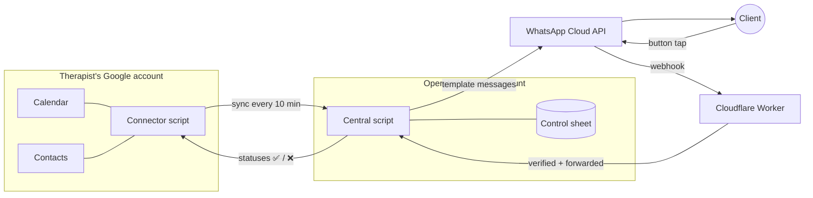

# WhatsApp Appointment Reminders

[](https://github.com/sagiassraf/therapy-reminders/actions/workflows/test.yml)

Automatic WhatsApp reminders for therapists' and coaches' clients. Each client gets a reminder **24 hours before** and **1 hour before** every session, with **Confirm / Cancel** buttons. Replies update the therapist's Google Calendar. When a client cancels, the therapist gets a WhatsApp alert.

It runs on free tiers only (Google Apps Script and Cloudflare Workers). The only cost is Meta's per-message fee, about $0.006 per reminder in Israel.

> 🇮🇱 מדריכי ההתקנה בעברית: [הקמה חד פעמית](docs/01-setup.md) · [קליטת מטפל חדש](docs/02-onboard-client.md)

## How it works



| Component | Runs on | Responsibility |
|---|---|---|
| [`connector/`](connector/Code.gs) | Apps Script, bound to each therapist's copy of a template sheet | Reads the next 48h of calendar events, matches event titles to Google Contacts (People API), syncs with central, prefixes titles with ✅ or ❌ |
| [`central/`](central/Code.gs) | Apps Script web app, bound to the operator's control sheet | Stores appointments, sends due reminders (5-minute trigger), handles button replies, alerts the therapist on cancellation |
| [`worker/`](worker/worker.js) | Cloudflare Worker (free tier) | Verifies Meta's `X-Hub-Signature-256`, answers 200 immediately, forwards to central |

## Design decisions

- **Why a connector in each therapist's account?** Only code running as the therapist can read their contacts, so the phone lookup happens there. The connector never holds the WhatsApp token, and all business logic stays in central. A fix is deployed once and applies to every customer.
- **Why a Cloudflare Worker?** Apps Script web apps answer POST requests with a 302 redirect, and Meta's webhooks need a plain 200. The Worker also checks the HMAC signature before anything reaches the spreadsheet.
- **One business number for all therapists.** Onboarding a therapist then needs no Meta setup. They copy a sheet, paste an activation code and approve permissions, in about five minutes.
- **An appointment's key is `eventId + startTime`.** A rescheduled event becomes a new appointment with fresh reminder flags, and the old slot is marked `deleted`. This also handles recurring events, whose instances share one event id.
- **Idempotent webhook handling.** Meta retries webhooks, so a duplicate "cancel" tap never sends the therapist a second alert. A reply is accepted only from the phone number the reminder went to.
- **Sends fail closed.** A failed send is logged and marked as failed instead of being retried every 5 minutes, so one bad number can't spam the log or the API.

## Reminder rules

| Situation | Behavior |
|---|---|
| Booked at least 23h ahead | 24h reminder, then 1h reminder |
| Booked less than 23h ahead | 1h reminder only |
| Client tapped "Cancel" | No more reminders; ❌ in calendar title; therapist alerted |
| Client asked to reschedule, or is running late | 🔄 or ⏰ in calendar title; therapist alerted with the reason |
| Event moved or deleted | Reminders follow the new time, or are dropped |
| Title doesn't match a contact | No message; shown as "no phone" in the therapist's sheet. A phone number in the event description also works |
| Client sends free text | One auto-reply (at most every 6h) with the therapist's direct number |

## Tests

The Apps Script and Worker code run under Node with mocked Google services (Sheets, Properties, Cache, UrlFetch). There are no dependencies.

```bash
npm test
```

The tests cover:
- sync and authentication
- 24h and 1h timing, and late bookings
- duplicate suppression
- the confirm and cancel flows
- rescheduling and deletion
- the free-text auto-reply rate limit
- failure handling and cleanup
- webhook signature verification

## Setup

1. One-time setup takes about an hour: Google, Meta, Cloudflare. See [docs/01-setup.md](docs/01-setup.md) (Hebrew).
2. Each new therapist takes about five minutes. See [docs/02-onboard-client.md](docs/02-onboard-client.md) (Hebrew).

Required WhatsApp templates (Utility category): `reminder_24h`, `reminder_1h` and `therapist_alert`. Create them with `npm run templates` ([tools/create-templates.mjs](tools/create-templates.mjs)), which reads credentials from a git-ignored `.env`.

## Privacy

Only a name, phone number and appointment time are stored, never any clinical content. Past appointments are deleted automatically after 3 days.

## License

[MIT](LICENSE)
